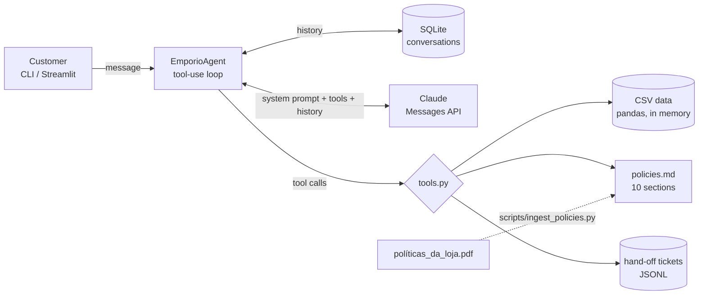

# Empório da Música — AI customer-service agent

Prototype of a text-message customer-service agent for **Empório da Música**, a (fictional) musical
instrument store in Campo Grande/MS. The agent — **Lia** — answers customers in Portuguese, looks up
live data (catalogue, prices, promotions, stock, orders) and applies the store's policy manual
(returns, payments, shipping, warranty, opening hours), and politely handles out-of-scope requests.

Built for the Artefact *AI Engineer – Full-Stack para Aplicações com IA Generativa* technical case.

```
Cliente: Me arrependi da minha compra, posso devolver meu pedido?
Lia:     Pode sim, dependendo do prazo! Me passa o número do pedido e o e-mail ou telefone do cadastro?
Cliente: É o pedido 7, meu e-mail é leticia.rocha@jmail.com
         🔧 consultar_pedido(7, …)  🔧 consultar_politicas(["trocas_devolucoes"])
Lia:     …seu pedido foi recebido há 3 dias, dentro dos 7 dias do direito de arrependimento…
```
*(illustrative — the real, unedited transcripts are in [`examples/`](examples/))*

---

## Contents
1. [Quick start](#1-quick-start)
2. [Architecture](#2-architecture)
3. [Technical decisions](#3-technical-decisions)
4. [Data treatment and findings](#4-data-treatment-and-findings)
5. [Assumptions](#5-assumptions)
6. [Example conversations](#6-example-conversations)
7. [Known limitations and next steps](#7-known-limitations-and-next-steps)
8. [Use of AI coding assistants](#8-use-of-ai-coding-assistants)

---

## 1. Quick start

Requirements: Python 3.10+ and an [Anthropic API key](https://console.anthropic.com/).

```bash
git clone <this-repo> && cd emporio-da-musica-agent
python -m venv .venv && source .venv/bin/activate      # Windows: .venv\Scripts\activate
pip install -r requirements.txt
cp .env.example .env                                     # then set ANTHROPIC_API_KEY in .env
```

| What | Command |
|---|---|
| Chat in the terminal | `python cli.py` (add `--debug` to see tool calls, `--session <id>` to resume a conversation) |
| Chat in the browser | `streamlit run app.py` → http://localhost:8501 (toggle "Mostrar ferramentas usadas" to inspect tool calls) |
| Run the tests (no API key needed) | `pytest` |
| Re-generate the example conversations | `python scripts/generate_examples.py` |
| Re-ingest the policy PDF | `python scripts/ingest_policies.py` |

Optional settings (`.env`):

| Variable | Default | Purpose |
|---|---|---|
| `CLAUDE_MODEL` | `claude-opus-5-5` | Any Claude model id, e.g. `claude-sonnet-5-5`, `claude-haiku-5-5` |
| `CLAUDE_EFFORT` | `low` | Reasoning effort (`low` / `medium` / `high`) |
| `ENABLE_FALLBACK` | `1` | Server-side refusal fallback (Claude API only; set `0` behind proxies/other platforms) |
| `AGENT_REFERENCE_DATE` | real date | Freeze "today" (`YYYY-MM-DD`) — useful because the dataset's orders are from 2025/early 2026 |
| `AGENT_DB_PATH` | `data/runtime/conversations.db` | SQLite file for conversation history |

---

## 2. Architecture



Per customer message, the agent loads the session history, calls Claude with the system prompt and
the tool schemas, executes whatever tools Claude requests (all requested tools in a round run and
return in a single message), and repeats until Claude answers in text (max 8 rounds). The completed
turn is then persisted atomically.

| Tool | Answers questions like | Data source |
|---|---|---|
| `buscar_produtos` | "violões até R$1000", "quanto custa o Takamine GD20?", "tem Yamaha?" | products + categories + active promotions |
| `detalhes_produto` | specs / description of a given product | products |
| `listar_promocoes_ativas` | "tem promoção?", "a Black Friday ainda vale?" | promotions (`is_active = 1`) |
| `simular_pagamento` | PIX price, max interest-free installments, payment combination | products + policy 3 rules (in code) |
| `consultar_pedido` | status, tracking, delay, return/exchange/warranty windows | orders + order_items + customers |
| `consultar_politicas` | address, hours, returns, shipping, warranty, scope… | `data/processed/policies.md` |
| `status_da_loja` | "estão abertos agora?", today's date | clock in `America/Campo_Grande` + policy 2 hours |
| `encaminhar_para_atendente` | complaints, cancellations, formal returns, human hand-off | writes a ticket with protocol number |

```
src/emporio_agent/
  config.py     settings from env, store timezone, frozen reference date
  data.py       CSV loading + cleaning (pandas)
  policies.py   policy sections and slug -> section mapping
  tools.py      tool implementations + JSON schemas + dispatcher
  prompts.py    system prompt (persona and operating rules)
  memory.py     SQLite conversation store
  agent.py      the tool-use loop
cli.py, app.py  interfaces            scripts/   ingestion + example generator
tests/          25 tests (tools, policies, persistence, agent loop with a fake client)
```

---

## 3. Technical decisions

### 3.1 Agent approach: function calling (tool use) with a hand-written loop
The questions this store receives fall into two families: **structured lookups** (price, stock,
order status — exact answers from tables) and **rules** (returns, payments, hours — text in a manual).
I gave the model one tool per *business capability* and let it decide which to call; Python does
the lookup and all the arithmetic.

Alternatives considered:
- **Pure RAG over everything** — embedding CSV rows works poorly for filters and aggregations
  ("violões até R$1000, mais baratos primeiro") and gives no guarantee on prices.
- **Text-to-SQL agent** — flexible, but a customer-facing bot that writes arbitrary queries over a
  table with customers' personal data is a privacy and correctness risk; the question space here is
  small and well known, so purpose-built tools are safer, testable and cheaper.
- **Frameworks (LangChain, LlamaIndex, LangGraph)** — not needed for one agent with 8 tools. The loop
  is ~100 lines with full control over persistence, error handling and refusals, and nothing hidden
  between the prompt and the model. Would reconsider for multi-agent flows or many integrations.

Key design rule: **the LLM chooses, the code computes.** Discounts, PIX price, installment limits,
"days since delivery" and "is this inside the 7-day window?" are computed in `tools.py` and returned
as explicit fields (`dentro_prazo_arrependimento_7_dias: false`), so the model explains decisions
instead of doing date math. The policy manual itself demands this (§7.1: never give prices, stock or
deadlines without checking the system).

### 3.2 Model and provider: Claude via the Anthropic API
- Default `claude-opus-5-5`, with `effort: low`. Tool selection and applying policy rules
  correctly matter more than raw speed in a prototype that is evaluated on correctness; low effort
  keeps latency and cost reasonable for chat. The model is one env var (`CLAUDE_MODEL`), so the
  same code runs on `claude-sonnet-5-5` or `claude-haiku-5-5`. In production I would pick the
  cheapest model that passes an eval set of real conversations (see §7).
- Strong native tool use (parallel tool calls, structured `tool_use` blocks), good Portuguese, and
  prompt caching.
- **Prompt caching**: the system prompt and tool definitions are static (no timestamps — the current
  date comes from a tool), and automatic caching (`cache_control`) reuses the prefix and previous turns.
- **Refusal fallback** (`ENABLE_FALLBACK`): if a safety classifier declines a request, the API
  re-runs it on a fallback model server-side; if it still refuses, the agent answers with a polite
  scope message and the turn is not persisted.

### 3.3 Retrieval for the policy manual: section routing instead of vector search
The manual is ~2.5k words in 10 clearly numbered sections. Instead of chunking + embeddings, the
`consultar_politicas` tool exposes the sections as an **enum of slugs** (`trocas_devolucoes`,
`formas_pagamento`, …) with a description of what each contains; the model asks for one or more
whole sections. Benefits: no chunking boundaries cutting a rule in half, no retrieval misses, no
vector DB or embedding model, and the model still "decides when to consult policies" explicitly
(visible in the transcripts). It scales to a few dozen sections; beyond that I would switch to hybrid
search (BM25 + embeddings) over sub-sections — the tool interface would stay the same.

Pre-processing: pypdf's default extraction returns one word per line for this PDF; **layout mode**
keeps the tables readable. `scripts/ingest_policies.py` runs once, removes page headers/footers and
writes `data/processed/policies.md`, which is version-controlled (easy to review and to diff when the
manual changes).

### 3.4 Prompt strategy
`prompts.py` defines the persona (Lia; informal-but-professional tone required by policy §7.1,
short WhatsApp-style messages, BRL formatting) and, most importantly, an explicit **"when to consult
what"** routing table that mirrors the tools, plus rules for applying policies (show original price +
discount % on promotions, suggest in-stock alternatives when something is sold out, never approve
refunds — open a ticket, never reveal order data without validation). Ambiguities in the manual are
resolved in a short "clarifications" block (see §5). Tool descriptions repeat the "when to use"
guidance, since the model reads them when choosing tools. The prompt is in Portuguese because that is
the conversation language; code, comments and docs are in English.

### 3.5 Safety and privacy
- **Order lookups require the order number + the customer's e-mail or phone** (LGPD, policy §9).
  On mismatch the tool says only that the data doesn't match — it does not reveal that the order
  exists or whose it is.
- The customer table is never exposed as a whole; no tool lists customers.
- Scope: accessories (strings, amps…) are declined per policy §1/§7.1; unrelated requests are declined
  in one friendly sentence; attempts to change the rules, reveal the prompt or obtain discounts are ignored.
- Hand-off tickets (`data/runtime/handoffs.jsonl`) keep humans in the loop for anything the agent must
  not decide (refunds, cancellations, complaints) with the 24-business-hour SLA from policy §7.3.

### 3.6 Interface and persistence
- **CLI** for fast iteration, **Streamlit** for a demo-able chat with an inspector of tool calls; both
  share the same `EmporioAgent`.
- **Conversation history in SQLite** (stdlib, zero setup). A customer may leave and come back
  ("my order number is…" an hour later), so history is per session id (`--session` in the CLI, `?session=` in
  the URL in Streamlit). The full API history (including tool calls/results) is stored append-only and
  written atomically per turn, so a failed turn never leaves a broken history.

---

## 4. Data treatment and findings

Cleaning done in `data.py`: parse `specs` JSON; join category names; join only **active**
promotions (`is_active = 1`) and keep the largest discount if a product had more than one; compute the
promotional price; build an accent-free, punctuation-free search text (so "violao", "Violões" and
"gd-20" all match); parse dates; normalise phone numbers to digits and e-mails to lowercase for
identity checks.

Issues found while exploring the data, and how they are handled:

| Finding | Handling |
|---|---|
| 21 of 25 promotions are inactive (e.g. Black Friday on the Takamine GD20) | Only active ones are applied; the prompt tells the agent to say transparently when a promotion has ended (policy §7.3) |
| Products with `stock_quantity = 0` (Giannini GF-3D), `discontinued` (Shelby SN-7C, Ibanez Bass 2X) and `coming_soon` (Kala KA-ABP-CTG) | Returned with `disponivel_para_compra` + human-readable availability; excluded when listing options |
| Categories 6, 7, 8 (woodwinds, brass, orchestral strings) have **no products** although the manual says they are sold | The agent says no models are currently available and offers a hand-off |
| Some descriptions contradict the product name (e.g. "Music Man Bass 1X" described as a Fender Jazz Bass; "Korg Synth 1" described as a Roland) | Not "fixed" (no source of truth); the agent shows the registered name. Flagged as a catalogue data-quality issue |
| Order totals differ from the sum of items in orders 3 (−R$48) and 20 (−R$88) | Agent reports the stored total (what was charged); likely discounts/freight not modelled |
| Order 3 contains a `coming_soon` product and was delivered | Left as is (historical record) |
| Two customer records share the e-mail `bruno.martins@jmail.com` (ids 11 and 43) | Validation is per order: the e-mail must match *that order's* customer, so no data leaks across the duplicate |
| No real delivery date in `orders` | `estimated_delivery` is used as receipt date for return windows; stated in the tool output and README |
| Manual: WhatsApp (67) 3341-4444 in "Dados da Empresa" vs (67) 3321-4500 in §7; e-mail with a typo (`empóriodamusica`) | See assumptions below |

---

## 5. Assumptions

1. **Contact data:** (67) 3341-4444 is the official phone/WhatsApp (company data table and cover page);
   the e-mail is `contato@emporiodamusica.com.br` (cover page; the accented domain is treated as a typo).
2. **Installments:** the detailed rules in §3.1 prevail over the summary table ("minimum R$100"):
   up to 3x with installments ≥ R$50 (I read "sem valor mínimo de parcela (exceto abaixo de R$ 50,00)" as a
   R$50 minimum), 4–6x ≥ R$80, 7–12x ≥ R$100. Purchases under R$100 can therefore still be split in 2x.
3. **Price filters** ("até R$1000") use the price the customer pays at list/promotional price, before the PIX discount.
4. **Return windows:** right of withdrawal and preference exchange count 7 days from receipt
   (estimated delivery); defect exchange counts 30 days from the purchase date (literal reading of
   §4.2); legal warranty 90 days from receipt. The agent never approves a return — it explains and opens a ticket.
5. **Holidays:** fixed-date national holidays close the store; movable and municipal holidays are not modelled.
6. **Cancellations** of pending/confirmed orders are not covered by the manual → hand-off to a human.
7. **Language:** customers write in Portuguese, so the agent answers in Portuguese; all deliverable
   documentation is in English as requested.

---

## 6. Example conversations

Generated by `scripts/generate_examples.py` against the real model, **unedited**, with the reference
date frozen at 2026-02-20 10:00 (a Friday) so the order-related scenarios are meaningful. Each file
shows which tools were called on every turn.

| File | Scenario | Non-trivial behaviour |
|---|---|---|
| [`01_catalogo_violoes.md`](examples/01_catalogo_violoes.md) | Guitars up to R$1000, recommendation, sold-out model | catalogue filters, PIX calculation, out-of-stock → alternatives |
| [`02_preco_parcelamento_promocao.md`](examples/02_preco_parcelamento_promocao.md) | Takamine GD20 price, installments, "is Black Friday still on?" | installment rules, expired vs active promotions |
| [`03_devolucao_arrependimento.md`](examples/03_devolucao_arrependimento.md) | "I regret my purchase, can I return it?" | identity check, order data + return policy, ticket |
| [`04_info_loja_e_fora_de_escopo.md`](examples/04_info_loja_e_fora_de_escopo.md) | Address/hours, strings & amplifier, school homework | policy lookup, accessories out of catalogue, off-topic |
| [`05_pedido_defeito_garantia.md`](examples/05_pedido_defeito_garantia.md) | Order status with wrong then right e-mail, defective pickup | LGPD check, 30-day window expired → legal warranty |

---

## 7. Known limitations and next steps

**Limitations**
- No automated evaluation of answer quality yet — tests cover tools and the loop, not the LLM's choices.
- History grows without bound within a session (fine for support chats; long sessions would need
  summarisation/compaction or a sliding window).
- Data is loaded from CSVs at start-up; stock and orders are "real-time" only relative to those files.
- Product search is lexical (tokens + light stemming); it does not understand "something for metal"
  unless those words are in the description.
- Shipping cost for other cities is not calculable (no table in the data) → hand-off.
- Hand-off tickets go to a local JSONL file; there is no real queue/CRM integration or customer authentication beyond e-mail/phone matching.
- Single-process, synchronous; no streaming of the answer to the UI.

**With more time I would**
1. Build an **eval set** (~50 real-style conversations with expected tool calls and graded answers,
   LLM-as-judge + exact checks on prices/deadlines) and use it to choose the cheapest model/effort that
   passes, and to catch regressions in the prompt.
2. Move data to a real database (Postgres/SQLite) behind the same tool functions, with stock read live.
3. Add semantic/hybrid product search (embeddings over name + description + specs) and a reranker.
4. Expose the agent as a **FastAPI** service with a WhatsApp Business webhook, streaming responses,
   per-customer authentication and observability (tracing of tool calls, latency and cost per conversation).
5. Integrate hand-offs with a ticketing/CRM tool and notify the human team.
6. Add guardrails tests (prompt injection, PII leakage) to CI.

---

## 8. Use of AI coding assistants

<!-- Cauã: review this section so it describes exactly what you did. -->

I used **Claude (Anthropic) through Claude Code** as a pair-programmer for this case. My workflow:

1. **Framing first.** I gave Claude the case PDF, the data and the policy manual and asked it to read
   everything before writing code. I made the key product decisions — LLM provider (Claude), interface
   (CLI + Streamlit) and that the work should be delivered in small, reviewable commits.
2. **Data exploration before design.** Claude profiled the CSVs and the PDF; the inconsistencies in
   §4 came out of this step and shaped the design (e.g. active-only promotions, identity check because
   of the duplicate e-mail, PDF layout extraction).
3. **Incremental implementation** — data layer → policy ingestion → tools → agent loop → tests →
   interfaces → docs — one commit per step (see the git history). Each step was run/tested before the next.
4. **Testing without spending tokens.** Tools and the agent loop are covered by `pytest` (the loop
   uses a fake client returning real SDK objects), so the logic was validated before any API call.
5. **Review and validation.** I reviewed the code and the decisions, ran the agent with my API key,
   generated the example conversations and checked them against the data and the policy manual.

What worked well: using the assistant to explore the data and to write the tests together with the code.
What I kept under my control: the scope, the trade-offs documented here and the final review.
